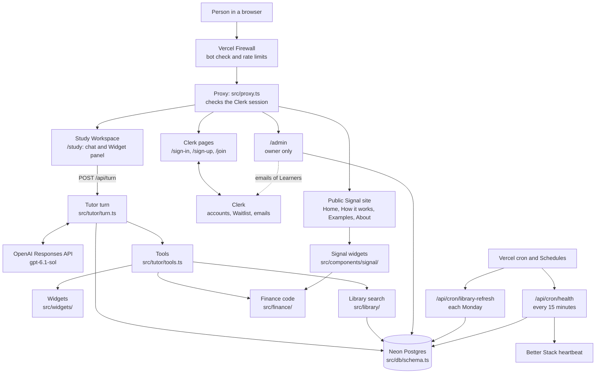
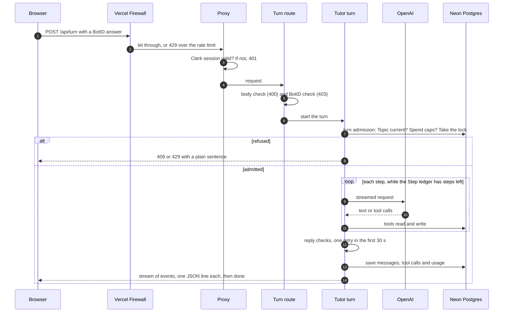

# Value It architecture

Facts as of 2026-11-16. This page describes `main` as it is now. It starts with the map, then zooms in, one layer at a time. File paths are signposts. The page shows no code.

Section 2 lists the most recent changes. ADR means an architecture decision record in [`docs/adr/`](adr/README.md).

## 1. The picture

Value It teaches money, markets and valuation through real past events. A visitor reads the public Signal site, which has five live Widgets. To come in, the visitor joins a Waitlist. The owner approves each person in Clerk, and Clerk signs them in with an email link. The person is then a Learner, and studies in the Study Workspace: chat with a Tutor on the left, Widgets on the right.

The Tutor is an OpenAI model, gpt-6.1-sol, on the Responses API. The server runs on Vercel, in region `sin1`. Each Learner action starts one Tutor turn on the server. During the turn, the model calls tools. The tools search a private Library of real sources, show Widgets, calculate, and record progress. Code checks replies before the Learner sees them. Daily Spend caps limit what each Learner and each day can cost. One Neon Postgres database keeps all state. The course is YAML files in the repo. A merge to `main` is the only way to deploy.

## 2. What changed on 2026-11-15 and 2026-11-16

**2026-11-15.** These pull requests merged into `main`, in this order:

| Area | PR | What it brought |
|---|---|---|
| Hardening | #36 | Spend caps, the Step ledger, turn admission, a Neon snapshot before each migration, the health check, previews off |
| CI | #39 | Sharded CI, a fast path for docs-only pull requests, Node 24, Dependabot |
| Clerk prep | #35 | `learners.clerk_user_id`, HSTS and Permissions-Policy headers, BotID on `POST /api/turn` |
| Backup | #40 | Option B: daily snapshots, a protected `main`, an off-Neon Library dump, a restore drill |
| Docs | #34 | ADRs 0001 to 0018 and `GLOSSARY.md` |
| Site | #47 | The public Signal site, the five Signal widgets, one Light theme |
| Clerk sign-in | #48 | Clerk replaces Better Auth: Waitlist, email link only, the owner found by Clerk role. Live in production |
| Library sources | #43 | New public sources, and a ranking rule that keeps one big source from filling the results |
| Reranker test | #42 | Reranker flags in the Library scorer. The reranker itself is parked: the app's search does not use it |

**2026-11-16.** Two runs by hand changed production:

- **The production Library load.** After a Neon snapshot, it loaded the new sources, dropped the 2nd edition of Principles of Finance and stored the embeddings. The scores passed (section 9).
- **The wipe.** After a dump, a Neon snapshot and a rehearsal on a Neon branch copy, it deleted the 2 pre-Clerk Learners and their history. One Learner is left: the owner's Clerk account (section 5.4).

Then two pull requests merged, in this order:

- **#44.** It deleted the dead lanes: the `compose_widget` tool, the engine-off lane and the old model comparison code (section 8).
- **PR C.** Its migration 0040 dropped the Better Auth tables, the other old sign-in tables, the model comparison tables and `learners.auth_user_id` (section 5.4).

Some tasks only the owner can do, for example: switch the firewall to enforce, make the Better Stack account, add the Google client for Clerk. The owner actions list (#41) holds them.

## 3. The map

The course (`course/`) is data that the Tutor turn reads. The deploy path is in section 10.

## 4. The request flow of one Tutor turn

Section 6 explains each step.

## 5. The layers

### 5.1 Public site (Signal)

A signed-out visitor can read these pages: Home (`/`), How it works (`/how-it-works`), Examples (`/examples`), the five Example pages (`/examples/<slug>`) and About (`/about`). The files are in `src/app/(site)/`. One data file, `src/site/examples.ts`, lists the five Examples. The proxy, the pages and Home all read it, so they always agree. The proxy also lets a signed-out visitor open `/join`, `/sign-in` and `/sign-up`.

Each Example shows one Signal widget: Jackpot, Four levers, Compounding, Rates or WeWork.

- Each Signal widget is one fixed React component (`src/components/signal/`). See [ADR 0011](adr/0011-signal-widgets-are-fixed-components.md).
- Its numbers come from tested models in `src/finance/signal/`. Four levers runs on the one valuation engine, `src/finance/dcf-engine.ts` ([ADR 0010](adr/0010-one-valuation-engine.md)).
- No Tutor runs on the public pages. The "Call" in a widget starts a Tutor turn only in the Study Workspace ([ADR 0012](adr/0012-only-the-call-starts-a-turn.md)).

The whole app has one Light theme, in the Signal colour language: five colours and one pattern, and each has one meaning ([ADR 0015](adr/0015-one-light-theme-colour-language.md)). The tokens are in `src/app/globals.css`. Controls are flat, sections use hairlines, and pictures are line icons ([ADR 0018](adr/0018-flat-controls-hairlines-line-icons.md)). The spec is [`docs/specs/value-it-signal-spec.md`](specs/value-it-signal-spec.md).

The site's join button opens `/join`, which shows Clerk's Waitlist (section 5.4).

### 5.2 Study Workspace (browser)

The main page is `/study`: chat on the left, Widgets on the right. Other signed-in pages are the Course Map (`/course`), the Notebook (`/notebook`), Settings (`/settings`), Profile (`/profile`) and each Library passage (`/passages/<id>`).

1. The Learner types a message or taps a Choice.
2. The page sends `POST /api/turn` with the message, the shown Session or Topic, and the open Widget values.
3. The page reads the reply as a stream of events, one JSON line per event.
4. The chat shows the text. The Widget panel draws each Widget.

Files: `src/app/study/page.tsx`, `src/app/conversation.tsx`, `src/app/thread.tsx`, `src/app/turn-stream.ts`, `src/app/widget-panel.tsx`, `src/app/widget-view.tsx`.

### 5.3 Front door: firewall, headers and proxy

Each request passes three layers before app code runs.

1. **Vercel Firewall**, at Vercel's edge. It only logs now (published 2026-11-15). On or after 2026-11-17, the owner reads the logs and switches it to enforce:
   - Bots get a challenge. AI crawlers are only logged.
   - More than 20 `POST /api/turn` in 60 seconds from one IP address get 429.
   - More than 120 other `POST /api/*` in 60 seconds from one IP address get 429.
   - The cron paths skip the rules.
   - Attack Challenge Mode is off. It is the emergency switch.

   The rule bodies are in [`docs/agents/platform.md`](agents/platform.md).
2. **Headers** (`next.config.ts`). Every page gets HSTS for two years with subdomains, a Permissions-Policy that turns off browser features the app never uses, a ban on framing, and `nosniff`.
3. **Proxy** (`src/proxy.ts`). It checks the sign-in (section 5.4).

### 5.4 Sign-in (Clerk)

Clerk hosts the sign-in, the sign-up, the Waitlist and the emails ([ADR 0017](adr/0017-clerk-replaces-better-auth.md)). Clerk went live in production on 2026-11-15 (#48). The Better Auth code is deleted.

**Join and approval**

1. A visitor opens `/join` (`src/app/join/page.tsx`) and leaves an email on Clerk's Waitlist.
2. The owner approves the person in the Clerk dashboard. Clerk sends the "You're in" email.
3. The invite link opens `/sign-up`. The person signs in with an email link. There is no password. Google sign-in is off for now.
4. On the first request, `src/auth/clerk-learner.ts` makes a Learner for that Clerk user and stores the id in `learners.clerk_user_id`. Every account has a Learner, so `/sign-in` and `/study` can never send a person back and forth.

Waitlist mode also stops the owner's own sign-up. So the owner's Clerk user was made in advance. An old `/login` link answers 308 and sends the browser to `/sign-in` (`next.config.ts`).

**Each request**

1. `src/proxy.ts` runs Clerk's middleware, which checks the Clerk session.
2. A signed-out visitor gets only the public pages, `/sign-in`, `/sign-up` and `/join`. Other pages send the visitor to `/sign-in`. An API call gets 401.
3. Before a page or route reads data, it reads the person again on the server (`src/auth/session.ts`). The identity comes from the session token alone, with no call to Clerk: user id, email, first name, and whether the person is the owner (`src/auth/identity.ts`).

**The owner.** The owner is the person whose Clerk `publicMetadata.role` is `"admin"`. Only the owner sets it, in Clerk. `src/auth/owner.ts` reads that claim from the session token. A passcode never makes a person the owner. Everyone else gets 404 on `/admin`. The `/admin` page (`src/app/admin/`) shows:

- **Tutor speed.**
- **Spend**, per person. `src/auth/clerk-directory.ts` asks Clerk for each person's email when the page opens. The database keeps only the Clerk user id.
- **Who may come in**: links to Clerk's Waitlist and Users pages. To take away a person's access, the owner bans them in Clerk.
- **Spend caps** (section 7).

**Passcode door: local and test only.** `src/auth/gates.ts` holds two switches:

- `clerkOn`: true when both Clerk keys are set and the browser test bed is off. While it is false, nothing calls Clerk.
- `passcodeDoorOpen`: true only outside production and off Vercel. So every deploy refuses every passcode.

The browser tests and the simulated Learner sign in with a passcode or a test-bed cookie, on a local server. So CI needs no Clerk keys and no network.

**Bot checks.** Clerk guards the sign-up with its own bot protection and lockout. BotID guards the start of each Tutor turn, because each turn costs a model call. `src/instrumentation-client.ts` adds the challenge in the browser, and `POST /api/turn` checks it. A bot gets 403. The list of protected requests is in `src/auth/bot-protection.ts`.

**Fresh start.** Two steps finished the move to Clerk:

1. The wipe, on 2026-11-16. The owner's run took a dump and a Neon snapshot. It rehearsed the wipe and migration 0040 on a Neon branch copy. Then it deleted the 2 old Learners that had no Clerk id, with their history. One Learner is left: the owner's Clerk account.
2. PR C. Its migration 0040 dropped the tables `user`, `session`, `account`, `verification`, `access_denials`, `invites`, `rate_limit` and `email_link_sends`, the model comparison tables `model_comparison_runs` and `model_comparison_answers`, and the column `learners.auth_user_id`. It kept `login_failures`, which the passcode door uses.

So no Better Auth table or column is left in the database.

### 5.5 Routes

Each API route does one job. Files: `src/app/api/*/route.ts`. The main ones:

- `turn`: one Tutor turn (section 6).
- `widget-state`: saves slider values.
- `case-data/[caseId]`: Case Data under the as-of rule.
- `admin/caps`: saves the Spend caps from `/admin`. Only the owner may call it.
- `cron/health` and `cron/library-refresh`: called by Vercel, not by people (section 12).
- `login` and `logout`: the passcode door (local and test only) and sign-out.

### 5.6 Database

One Neon Postgres database keeps all state: Learners, Sessions, messages, turns, tool calls, usage, Widget state, Library passages and settings. The app uses the drizzle ORM. The app uses a pooled connection. Migrations use a direct connection.

1. A developer changes `src/db/schema.ts`.
2. `npm run db:generate` writes a new SQL file in `drizzle/`.
3. On a production deploy, `scripts/migrate-on-build.mjs` takes a Neon snapshot, then applies the new files (section 10).

Every migration is expand-then-contract: first add, deploy, and only later remove. Clerk follows this rule: #35 added `learners.clerk_user_id`, #48 stopped all use of the old Better Auth column and tables, and PR C's migration 0040 removed them. The rules are in [`docs/agents/migrations.md`](agents/migrations.md). Files: `src/db/client.ts`, `src/db/one-write.ts`, `src/db/schema.ts`, `drizzle.config.ts`.

### 5.7 Course content

The course is data, not code. `course/outline.yaml` puts the Topics in order. Each file in `course/topics/` holds one Topic: its steps, Cases and written-ahead Widgets ([ADR 0001](adr/0001-topic-file-holds-the-teaching.md)).

1. `src/course/map.ts` loads the YAML once and keeps it in memory.
2. `src/course/navigator.ts` finds the Learner's place in the course.
3. The Tutor turn sends that place to the model as a context note.
4. `npm run check` validates the YAML and the generated `docs/course-map.md`.

## 6. How a Tutor turn works

1. The browser sends `POST /api/turn`. The body names one kind of turn, for example a message, a Choice, Next, a Widget report, resume or stop.
2. The route checks the body with zod (`src/tutor/turn-body.ts`). A bad body gets 400. Then BotID checks the request. A bot gets 403.
3. **Turn admission** (`src/tutor/turn-admission.ts`) asks every "may this turn run?" question, in this order:
   - Does the tab still show the Learner's current Topic? If not, 409.
   - Is a daily Spend cap reached? Then 429, with a plain sentence. Only a new turn is checked, not a resume (section 7).
   - Is another turn running? The lock allows one turn per Learner. A second send gets 409. A resume past the resume limit gets 429.
   - For Next or a follow-up: is there something to do? If not, 409, and the lock is free again.

   A refusal saves nothing and calls no model.
4. `src/tutor/session-log.ts` finds the Session for the current Topic, or starts one. A new Session freezes the model, effort, instructions and tools ([ADR 0005](adr/0005-one-session-per-topic.md)). After a deploy changes the instructions or tools, the next turn refreezes them in the same Session. The effort stays.
5. `src/tutor/context.ts` and `src/tutor/widget-context.ts` add notes: course place, progress, and open Widget values.
6. The tool loop (`src/tutor/runner.ts`) sends a streamed request to OpenAI (`src/tutor/openai.ts`). Before each step, it asks the **Step ledger** (`src/tutor/step-ledger.ts`) how many steps are left. The last allowed step asks the model for text only, with no tool calls, so the turn always ends with a reply.
7. The model can call a tool. `src/tutor/tools.ts` runs it, and the loop sends the result back. This repeats until the model stops.
8. The reply checks run ([ADR 0006](adr/0006-replies-checked-before-they-show.md)):
   - A step-led reply (after Next, a Choice or a Quick try) is held until code checks it all (`src/tutor/reply-gate.ts`, `src/tutor/reply-checks.ts`). Code fixes small problems.
   - A reply to the Learner's own question streams at once, one sentence at a time, behind a stream guard (`src/tutor/stream-guard.ts`).
9. A broken held draft gets one retry, but only in the first 30 seconds of the turn. After that, the Learner gets a fallback that tells the truth.
10. `src/tutor/cite-markers.ts` turns citation markers into stored citations.
11. The turn saves messages, tool calls, Session items and usage. It sends a final `done` event.

Limits and recovery:

- The turn stops itself at 270 seconds (`TIME_BUDGET_MS`). Vercel allows 300. The browser then resumes the turn in a new request. A turn can resume at most 2 times.
- A Stop sets a flag. The running turn reads the flag every half second.
- A long Session is compacted at 200,000 input tokens.
- A failed turn shows the Learner a plain sentence with a reference. The `turns` table keeps the status (`src/tutor/failures.ts`).

The app keeps messages in its own transcript format (`src/tutor/model.ts`). `src/tutor/openai-items.ts` translates that format to OpenAI items and back. Each request asks OpenAI not to store the response (`store: false`). The app replays encrypted reasoning from its own records ([ADR 0007](adr/0007-one-model-behind-our-own-transcript.md)).

## 7. Spend caps

Each layer of a turn has a limit, so each layer has a known worst case (decision #13). The numbers are rows in the `settings` table. The owner edits them on `/admin`.

| Cap | Default | Checked |
|---|---|---|
| Turns per Learner per day | 120 | Turn admission, new turns only |
| Dollars per Learner per day | $5 | Turn admission, new turns only |
| Dollars for everyone per day | $30 | Turn admission, new turns only |
| Model steps per turn, all runs together | 10 | Step ledger, before each step |
| Resumes per turn | 2 | Turn admission, on resume |

- The owner has no per-Learner cap. The check finds the owner by the Clerk role, never by a passcode. The owner's spend still counts toward the cap for everyone.
- A day starts at midnight, India time.
- The dollars are estimates from the `usage` rows of each step. A step with no price counts as $0.66, the worst case. So a model change cannot hide spend.
- The evals, the Library refresh and Voyage are not counted. Only the OpenAI project's hard spend limit catches those.
- The evals run with `noLimits`, so no cap stops them.

**The Step ledger** counts the model steps of one turn, across all its runs (the first run and each resume). Every saved step counts: a loop step, a reply retry, a fold or compaction, and a step cut short. Before each step, the tool loop asks the ledger how many steps are left. The last allowed step must write the reply.

Files: `src/tutor/quota.ts`, `src/tutor/step-ledger.ts`, `src/tutor/turn-admission.ts`.

## 8. How generative UI works

The Tutor never writes Widget code. It picks a recipe and supplies the numbers. Tested code does the rest ([ADR 0009](adr/0009-tutor-chooses-code-draws.md)).

1. The Tutor calls `show_widget` with a recipe id and params: `title`, `inputs`, `refs` and `facts`.
2. `src/tutor/tools.ts` finds the recipe and parses the params with zod. The recipe's compile step then writes an OpenUI Lang program (`src/widgets/recipes/define.ts`).
3. The server runs more checks. Only one Widget per reply is allowed. Each ref must pass the as-of rule. `src/widgets/check.ts` checks the program against the frozen schema (`src/widgets/frozen-schema.generated.json`).
4. A failed check returns "Not shown" and the reason. The Tutor tries again or teaches in words.
5. The turn stores the program as a Session item (`src/widgets/shown-widget.ts`). The chat shows only a chip.
6. The browser draws the program with the OpenUI Renderer and the app's own parts (`src/app/widget-view.tsx`, `src/widgets/library.tsx`).
7. A slider move runs tested finance code in the browser (`src/widgets/tools.ts`, `src/finance/`). The model does not run.
8. `POST /api/widget-state` saves the slider values. The Tutor gets them with the next message.

Every number has a known origin:

- `inputs`: slider ranges and calculator inputs. Tested code works out the results.
- `refs`: Case Data, checked against the as-of rule (`src/case-data/case-data.ts`).
- `facts`: free numbers. Any fact labels the Widget "Illustration".

Other Widget tools: `open_widget` opens a written-ahead Widget from the Topic YAML. `update_widget` moves the sliders of an open Widget. Workbench Widgets (`src/widgets/workbench/`) get their figures on the server, from `src/finance/valuation-cases.generated.ts` or the Topic YAML.

The widget engine is the only Widget lane, and every Session freezes it. #44 deleted the two older lanes, the free-form `compose_widget` tool and the engine-off lane, and the old model comparison code. ADR 0011 plans a thin recipe part, so that the Study Workspace can open the five Signal widgets. That part is not built.

## 9. How the Library (RAG) works

**Sources.** `scripts/library/sources.json` lists each source with its licence and credit line. The repo holds the loaders, not the source text. #43 added these sources:

- OpenStax Principles of Finance, 1st edition (CC BY 4.0). It replaced the 2nd edition (CC BY-NC-SA 4.0).
- FOMC statements, minutes and policy records, 1979 to 2001.
- SEC filings: Amazon 1997 to 2000, Webvan 1999 to 2001, and the We Company S-1 of 2019.
- Investor.gov explainers. This entry is in the list, but it is not loaded: the site refused the fetcher (403).

Since the load on 2026-11-16, production holds no 2nd edition passages. Its entry is still in `sources.json`.

**Ingest** runs by hand, not on deploy:

1. The fetchers in `scripts/library/` get the text.
2. `src/library/prepare.ts` cuts each document into passages of 300 words or fewer.
3. `scripts/library-load.mjs` and `src/library/ingest.ts` write sources and passages to Postgres. A blocklist drops unwanted sources.
4. `scripts/library-embed.mjs` stores a Voyage embedding (voyage-4) for each passage in a pgvector column.
5. `scripts/library/drop-source.mjs` removes one source in one transaction. It is a dry run unless told otherwise.

Pictures and spreadsheets have their own loaders (`scripts/library-pictures.mjs`, `scripts/library-sheets.mjs`). Each week, the cron route (`src/app/api/cron/library-refresh/route.ts`) runs `src/library/refresh.ts`. It adds new or edited posts from Damodaran's blog.

**New sources are tested on a copy first.** They load first into a Neon branch copy, not into `main`. There they are embedded and scored. Only after a pass do they load into production. The bars are: 72 or more of 78 questions with the right passage in the top 5 (92%), MRR of 0.82 or more, and clean outcome-word probes. On 2026-11-15, the new Library passed on a copy: 75 of 78, MRR 0.827, probes 19 of 19. The write-up is [`docs/library/2026-11-15-sources-eval.md`](library/2026-11-15-sources-eval.md).

**The production load** is a separate step by hand. It ran on 2026-11-16:

1. A Neon snapshot of production.
2. Load the new sources: the 1st edition (1,043 passages), the FOMC records (4,013), and the SEC filings of Amazon (765), Webvan (749) and the We Company S-1 (801).
3. Drop the 2nd edition (1,043 passages).
4. Re-stamp the licence and credit lines.
5. Store the Voyage embeddings.
6. Score search on production again.

Scores on production, with BM25 and Voyage together:

- 75 of 78 questions have the right passage in the top 5 (96.2%, bar 92%). 58 have it first. MRR is 0.827 (bar 0.82). Pass.
- The outcome-word probes are clean: 19 of 19.
- The 12 open Signal questions: 9 of 12 in the top 5, MRR 0.542.
- With keywords only (no Voyage): 71 of 78, MRR 0.715.

After a load, re-dump the Library (section 11).

**Search** runs on each `search_library` call:

1. `src/library/library.ts` finds the as-of date from the Cases of the Learner's current Topic. After the reveal, no date applies.
2. `src/library/voyage.ts` embeds the query. Without `VOYAGE_API_KEY`, search uses keywords only.
3. `src/library/search.ts` runs two rankings of 30 candidates each: BM25 keyword match and vector distance. Without the BM25 index, the keyword half uses Postgres full-text rank. Both rankings apply the as-of rule.
4. Reciprocal rank fusion (k = 60) merges the two lists.
5. The source-mix rule (below) puts the list in order. The top 5 passages go back.
6. The Tutor sees each passage with a credit line and numbered sentences.

**Source-mix rule** (#43, called "A2" in the eval). The FOMC records and SEC filings add thousands of passages that repeat the same words. Without a rule, they filled the top 5 and pushed out the passages that explain. So a search that is not scoped to one source works like this:

1. A document is one chapter, lecture, paper, post or filing.
2. The list starts with the best passage of each document.
3. Each source gives at most its best 2 documents to the start of the list (`PER_SOURCE`).
4. An archival source gives only 1 (`ARCHIVAL_PER_SOURCE`). Archival sources are the FOMC records and SEC filings: their ids start with `fomc-` or `sec-`.
5. All other passages follow in fused order.

A search scoped to one source (the Tutor names a writer, a title or a source) keeps the plain fused order.

**Reranker: parked.** #42 added `--rerank` and `--pool` flags to the scorer, so a Voyage reranker can be tested again later. The app's search does not rerank. The numbers are in [`docs/library/2026-11-15-reranker-retest.md`](library/2026-11-15-reranker-retest.md).

**As-of rule** ([ADR 0013](adr/0013-as-of-rule-hides-hindsight.md)). A Case can stop before its outcome. Until the reveal, the Library hides hindsight:

- A passage from a dated source passes if it was published on or before the as-of date.
- A passage from a timeless source passes if every year its text mentions is before the as-of year. Only the text counts, never the heading.
- Both rankings apply the rule, before the fusion.
- Outcome-word probes check that no passage that passes tells the ending. The scorer's hindsight judge is `src/library/hindsight.ts`.

**Citations.** The model writes a marker after a claim, such as `⟦id:from-to⟧`. Code removes the marker and stores a citation (`src/tutor/citations.ts`). Each citation links to the passage page (`src/app/passages/[id]/page.tsx`).

**Eval.** `scripts/library-score.mjs` scores search on `scripts/library/eval/questions.json`. The pure parts (flags, answers, tallies) are in `src/library/score.ts`.

## 10. Deploy and CI

Only `main` deploys to production ([ADR 0016](adr/0016-only-main-deploys.md)).

1. Work happens on a branch. Branch names use dashes, not `/`. A pull request goes to `main`.
2. GitHub Actions runs CI (`.github/workflows/ci.yml`). Three checks are required: `check`, `build` and `ui`.
3. Each pull request gets one adversarial review comment. Then it merges by squash, on green checks.
4. A merge to `main` starts a Vercel production build. `npm run vercel-build` runs `scripts/migrate-on-build.mjs`, then `next build`.
5. **Snapshot gate.** If migrations are pending, the build first takes a Neon snapshot of the branch (kept 30 days). No snapshot means no migration and a failed build. In production, a missing `NEON_API_KEY` or `NEON_PROJECT_ID` also fails the build. `NEON_SNAPSHOT=off` is the only way past the gate, and the build log then shows a warning.
6. Vercel deploys the functions to region `sin1` (`vercel.json`).
7. **Deployment Checks.** Vercel holds the production address on the old deploy until `check`, `build` and `ui` pass on the new commit. Each check waits up to one hour. A red `ui` on `main` holds every production deploy.

The migration runs before `next build`. ADR 0016 wants it after the build. That step is not built yet. So a migration must never break the code that is live (expand-then-contract, section 5.6).

Guards:

- **Previews are off.** `vercel.json` sets `"main": true, "**": false`, so no other branch builds.
- **No one deploys by hand.** `.claude/settings.json` denies the risky commands to agents: production deploys, promote, rollback, and running migrations against production.

**CI** (#39). The details are in [`docs/ci.md`](ci.md).

- Node 24 everywhere, pinned in `.nvmrc` and `engines`, so CI and Vercel agree.
- The jobs run in parallel. `static` runs types, lint, the course check, the ADR cite check and the theme contrast check. The unit tests run in 4 shards. `next-build` builds with no secrets, then checks that no test code is in the build. The Playwright browser tests run in 6 shards.
- The required checks sum up those jobs: `check` (static and unit tests), `build` and `ui`. Do not rename them: the ruleset and the Deployment Checks use these names.
- A docs-only pull request skips the heavy jobs. `check`, `build` and `ui` still pass in seconds, so its merge never waits. A push to `main` always runs every job.
- Playwright retries a failed test once in CI and reports it as flaky.
- Dependabot opens one grouped update pull request a week for npm and one for GitHub Actions. Minor and patch updates merge on green CI. A Dependabot merge does not start CI on `main`, so production gets that update with the next merge that runs CI.
- The GitHub ruleset requires a pull request, an up-to-date branch, squash merges, and the three checks.

**The bundle check.** `scripts/check-bundle.mjs` measures Home on a production build (`next build`). It is not part of CI: run it by hand before a merge that changes what Home loads.

- It opens Home signed out and adds up the compressed script that loads before the first tap. The budget is 350 KB.
- It also measures the largest paint on a mid-range phone on 4G. The target is 2.5 seconds. This part never fails the check.
- Exit 0 means within the budget, 1 means over it, and 2 means the measurement is incomplete. An incomplete result is never a pass.
- The Widget panel uses OpenUI, which ships as one large file. `next.config.ts` swaps its unused heavy parts (a code highlighter of about 780 KB, a date picker and a table engine) for small stand-ins, so they stay out of the browser. The reasons are in `src/widgets/openui-stubs/README.md`.

## 11. Backups and restore

Recovery has layers. #8 chose option B (#40). The details and the restore steps are in [`docs/backup-and-restore.md`](backup-and-restore.md).

| Layer | What it covers | How far back |
|---|---|---|
| Neon point-in-time restore | A bad write or delete found soon | 7 days |
| A snapshot before each production migration | A bad migration | 30 days |
| A daily snapshot of Neon `main`, at 22:00 UTC | A bad change found later | 14 days |
| Neon `main` set as protected | Deleting `main` by mistake | Always on |
| An off-Neon dump of the `library_*` tables | A lost Neon project | The last dump |

- `scripts/backup-drill.sh` dumps the Library tables to the VPS. It then restores them into a throwaway Neon branch and compares counts and hashes. The first drill passed on 2026-11-15.
- The dump and its second copy are on the same VPS disk. The owner must still copy the dump to their laptop.
- Re-dump after each Library load. The last dump is from 2026-11-15, before the production load on 2026-11-16. Never put a dump in git: some source text is for private search only.
- Learner data stays in Neon only. A full off-Neon dump of Learner data was too much for about 20 beta Learners.

## 12. Monitoring

- **Health check.** Every 15 minutes, Vercel Schedules call `/api/cron/health` (`vercel.json` `schedules`). It reads failed turns, Tutor incidents, killed turns and the last Library refresh (`src/alerts/health.ts`). It reports to a Better Stack heartbeat:
  - all well: a plain beat;
  - a problem: a `/fail` call with a short list of counts and references, never Learner text;
  - the database does not answer: nothing, so Better Stack alerts on the missed beat.

  Until the owner sets `BETTERSTACK_HEARTBEAT_URL`, the check runs but nobody gets an alert.
- **Library refresh.** Each Monday at 21:30 UTC, a Vercel cron calls `/api/cron/library-refresh`.
- Both cron routes skip the proxy. Each checks `CRON_SECRET` itself (`src/auth/cron.ts`).

## 13. Configuration

Settings live in three places:

1. **Environment variables**: secrets and connection strings. Production values live in Vercel project settings. Local values live in `.env`, which git ignores. `.env.example` lists the names.
2. **The `settings` table**: values you can change without a deploy.
3. **Constants in code**: values that change only with a deploy.

**The rule:** secrets live in Vercel env. Never put a secret in the repo. Never give a secret a `NEXT_PUBLIC_` prefix: that sends it to the browser. An env change reaches only new deploys.

| Variable | Purpose |
|---|---|
| `OPENAI_API_KEY` | All model calls |
| `DATABASE_URL` | Pooled database connection for the app |
| `DATABASE_URL_UNPOOLED` | Direct connection for migrations |
| `NEON_API_KEY`, `NEON_PROJECT_ID` | The snapshot gate. Production only |
| `NEON_SNAPSHOT` | Set to `off` only to migrate with no snapshot. Remove it after that deploy |
| `NEXT_PUBLIC_CLERK_PUBLISHABLE_KEY`, `CLERK_SECRET_KEY` | Clerk. The publishable key is public by design. The secret key is a secret. Live keys go to Production only, test keys to Development |
| `CLERK_JWT_KEY` | Optional. Lets the server check Clerk tokens with no network call |
| `CRON_SECRET` | Lets only Vercel call the cron routes |
| `BETTERSTACK_HEARTBEAT_URL` | Where the health check reports. Optional |
| `VOYAGE_API_KEY` | Vector half of Library search |
| `PASSCODES`, `SESSION_SECRET` | The passcode door and the test-bed cookie. Local and test only. Production refuses every passcode. The owner removes them from Production (owner actions, #41) |
| `E2E` | Turns on the browser test bed. Never in production |
| `TURN_TIME_BUDGET_MS` | Optional, for local cut-off tests |

Not needed any more: `BETTER_AUTH_SECRET`, `BETTER_AUTH_URL`, `GOOGLE_CLIENT_ID`, `GOOGLE_CLIENT_SECRET`, `RESEND_API_KEY`, `EMAIL_FROM` and `PASSCODE`.

The `settings` table holds `effort` (default `medium`), `session_idle_hours`, `compact_at_tokens`, `review_cap` and the five Spend caps (section 7). The defaults are in `src/tutor/session-log.ts`. A Session keeps its `effort` from when it starts, so an `effort` edit reaches only new Sessions. The other rows take effect on the next turn or request. Nothing reads an old `widget_engine` row: every Session uses the widget engine (#44).

Constants: `TUTOR_MODEL` and `DEFAULT_EFFORT` (`src/tutor/model.ts`), `TIME_BUDGET_MS` (`src/tutor/turn.ts`), `maxDuration` (`src/app/api/turn/route.ts`), `POOL`, `RRF_K`, `PER_SOURCE` and `ARCHIVAL_PER_SOURCE` (`src/library/search.ts`), the 300-word cut (`src/library/prepare.ts`), region, crons and Schedules (`vercel.json`). A change to `TUTOR_MODEL` closes each Learner's live Session on their next turn.

## 14. Where to look in the code

| Question | Look here |
|---|---|
| Which pages are public? Who gets through? | `src/proxy.ts` |
| Which Examples does the site show? | `src/site/examples.ts`, `src/app/(site)/` |
| Where are the Signal widgets? | `src/components/signal/`, `src/finance/signal/` |
| Where are the colours and theme? | `src/app/globals.css` |
| Where does a visitor join? | `src/app/join/page.tsx` |
| How does sign-in work? | `src/auth/session.ts`, `src/auth/identity.ts`, `src/auth/gates.ts` |
| How does an account get its Learner? | `src/auth/clerk-learner.ts` |
| Who is the owner? | `src/auth/owner.ts` |
| What does `/admin` show? | `src/app/admin/`, `src/auth/clerk-directory.ts` |
| Where are the security headers and BotID? | `next.config.ts`, `src/auth/bot-protection.ts`, `src/instrumentation-client.ts` |
| May this turn run? | `src/tutor/turn-admission.ts`, `src/tutor/quota.ts` |
| How many steps may a turn take? | `src/tutor/step-ledger.ts` |
| What does the Tutor read as instructions and tools? | `src/tutor/instructions.ts` |
| What does each tool do? | `src/tutor/tools.ts` |
| How does a turn run? | `src/tutor/turn.ts`, `src/tutor/runner.ts` |
| How does the app call OpenAI? | `src/tutor/openai.ts`, `src/tutor/openai-items.ts` |
| Which model and effort? | `src/tutor/model.ts`, `settings` table |
| What does code check in a reply? | `src/tutor/reply-checks.ts`, `src/tutor/reply-gate.ts`, `src/tutor/stream-guard.ts` |
| Which Widget recipes exist? | `src/widgets/recipes/index.ts` |
| How does a Widget draw? | `src/app/widget-view.tsx`, `src/widgets/library.tsx` |
| Where is the finance math? | `src/finance/` |
| Which Library sources exist? | `scripts/library/sources.json` |
| How does Library search rank? | `src/library/search.ts` |
| How is Library search scored? | `scripts/library-score.mjs`, `src/library/score.ts`, `docs/library/` |
| How do citations work? | `src/tutor/cite-markers.ts`, `src/tutor/citations.ts` |
| Where is the course? | `course/outline.yaml`, `course/topics/`, `src/course/map.ts` |
| Where are the tables? | `src/db/schema.ts`, `drizzle/` |
| What runs on deploy? | `vercel.json`, `scripts/migrate-on-build.mjs`, `.github/workflows/ci.yml` |
| How does CI work? | `docs/ci.md`, `.github/workflows/ci.yml` |
| How are backups made and restored? | `docs/backup-and-restore.md`, `scripts/backup-drill.sh` |
| What does the health check read? | `src/alerts/health.ts`, `src/app/api/cron/health/route.ts` |
| Which commands are agents denied? | `.claude/settings.json` |
| How are Vercel, the firewall and Clerk set up? | `docs/agents/platform.md` |

## 15. Decisions

Each big choice has an ADR. The index is [`docs/adr/README.md`](adr/README.md). The ones this page leans on most:

- [ADR 0007](adr/0007-one-model-behind-our-own-transcript.md): one OpenAI model, behind the app's own transcript format.
- [ADR 0009](adr/0009-tutor-chooses-code-draws.md): the Tutor chooses a recipe, and tested code draws it.
- [ADR 0011](adr/0011-signal-widgets-are-fixed-components.md): each Signal widget is one fixed React component.
- [ADR 0013](adr/0013-as-of-rule-hides-hindsight.md): the as-of rule hides hindsight.
- [ADR 0016](adr/0016-only-main-deploys.md): only `main` deploys, behind checks and a snapshot.
- [ADR 0017](adr/0017-clerk-replaces-better-auth.md): Clerk replaces Better Auth.

## 16. Words

[`GLOSSARY.md`](../GLOSSARY.md) at the repo root holds the domain words. The main ones:

- **Learner**: a person who studies in the app.
- **Owner**: the one person who runs Value It and decides who may come in.
- **Tutor**: the model, with its instructions and tools.
- **Turn**: one Learner action and the Tutor's full reply.
- **Session**: one conversation about one Topic.
- **Topic**: one lesson in the course.
- **Case**: a real company or event that a Topic studies.
- **As-of date**: the date a Case stands at, before its outcome.
- **Widget**: an interactive picture in the Widget panel.
- **Signal widget**: one of the five fixed widgets on the public site.
- **Recipe**: a tested Widget template that the Tutor fills.
- **Library**: the store of passages from real sources.
- **Passage**: one cut of 300 words or fewer from a source.
- **Spend**: the estimate of what one person's Tutor costs.
